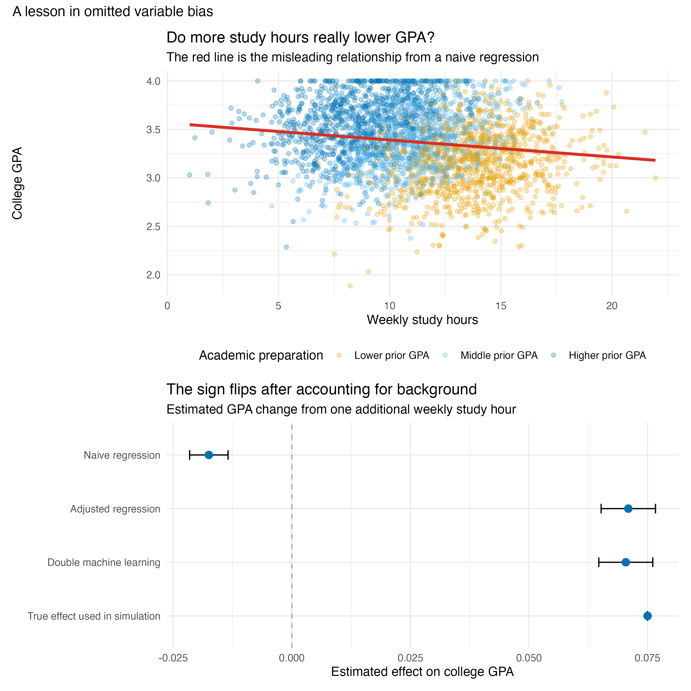

Students are usually told that studying more leads to better grades. Yet in a simulated dataset of 3,000 students, a simple regression gives the opposite result: one additional hour of weekly study is associated with a **0.018-point decrease** in college GPA. Should students close their textbooks?

No. The regression is making the wrong comparison. This surprising result illustrates **omitted variable bias**: when an important factor is missing from a model, its influence can be mistakenly attributed to a variable that remains.

## The comparison is the problem

Imagine two students. One entered college with strong academic preparation, studies six hours per week, and earns a high GPA. The other began with weaker preparation, studies fourteen hours because the material takes longer to master, and still earns a lower GPA. Comparing these two students could make studying look harmful, even if an extra hour helps each student.

The useful comparison is not simply “students who study more” versus “students who study less.” It is students with similar preparation, attendance, sleep, and stress who differ in study time. Regression controls are an attempt to make that more like-for-like comparison.

## A deliberately misleading dataset

I generated 3,000 fictional students with a fixed random seed. Each student has a high school GPA, attendance rate, sleep duration, stress level, weekly study time, and college GPA. The simulation deliberately makes students with weaker prior preparation or lower attendance study longer. At the same time, stronger preparation and more study time both raise college GPA. Before applying the 0–4 GPA boundary, the true effect built into the simulation is **+0.075 GPA points per additional weekly study hour**.

The complete analysis is available in the [reproducible R script](bp1_gpa_ovb.R), and the [simulated dataset](bp1_gpa_simulated_data.csv) contains no real student records.

```{r}
#| eval: false
#| code-fold: true

naive_model <- lm(college_gpa ~ study_hours, data = students)

adjusted_model <- lm(
  college_gpa ~ study_hours + high_school_gpa + attendance +
    sleep_hours + I((sleep_hours - 7)^2) + stress + I(stress^2),
  data = students
)
```

{fig-alt="A scatterplot of study hours and college GPA followed by a coefficient plot comparing naive regression, adjusted regression, double machine learning, and the true simulated effect."}

The red line in the upper panel slopes downward because it combines two relationships. Within similar students, more studying helps. Across students, those who begin with weaker preparation tend to study longer and earn lower GPAs. The unadjusted line confuses the second pattern with the first.

## Omitted variable bias, step by step

Let $Y$ be college GPA, $D$ be study hours, and $A$ be prior academic preparation. The relationship of interest is

$$Y = \beta D + \gamma A + \varepsilon.$$

Three facts create the misleading result:

1. Prior preparation raises college GPA, so $\gamma$ is positive.
2. Students with weaker preparation study more, so preparation and study time are negatively related.
3. If preparation is omitted, the study-time coefficient absorbs part of that negative relationship.

The simple regression therefore mixes the positive effect of studying with the disadvantage faced by students who need to study longer. After controlling for the observed background variables, the estimate changes from **−0.018** to **+0.071 GPA points** per additional weekly study hour. The adjusted comparison is much closer to the true simulated effect of +0.075.

## Where double machine learning helps

Ordinary regression requires the analyst to specify how every control enters the model. That can be difficult when relationships are nonlinear. **Double machine learning (DML)** uses flexible models to predict both GPA and study time from the background variables, then relates the unexplained parts of the two outcomes.

I used XGBoost with five-fold **cross-fitting**, meaning that each student's prediction came from a model trained on other students. The DML estimate is **+0.070**, with a 95% confidence interval from **+0.065 to +0.076**. It closely matches the adjusted regression and the true value used in the simulation.

DML still cannot control for information that was never measured. If motivation or family support affects both study time and GPA but is absent from the data, bias may remain.

## Takeaway

A regression coefficient depends on **who is being compared**. The negative unadjusted estimate does not show that studying lowers GPA; it shows that students who study for different amounts of time also differ in important ways. Before interpreting any coefficient causally, ask which common causes of the treatment and outcome may have been omitted—and whether the model is making a credible like-for-like comparison.
