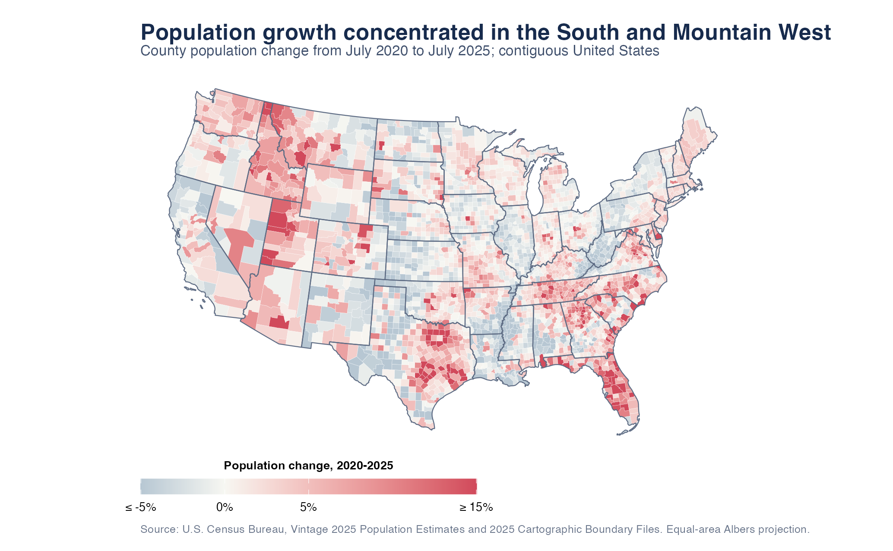
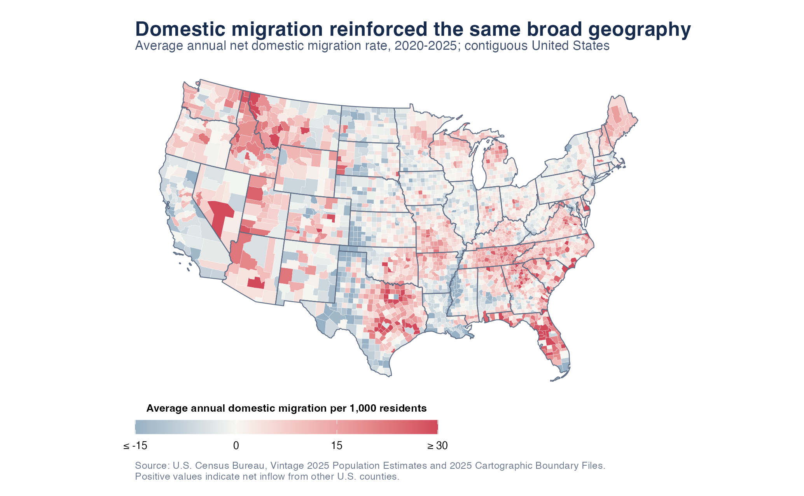
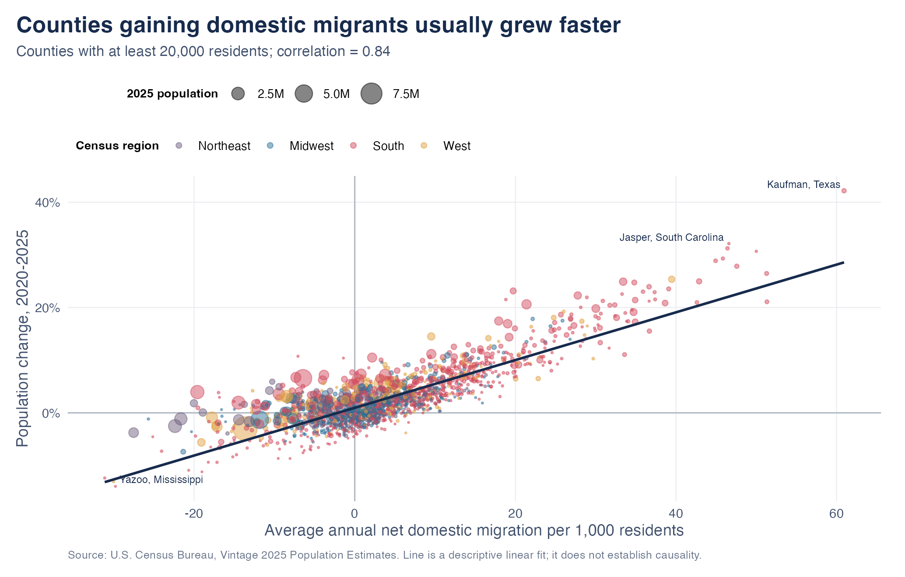
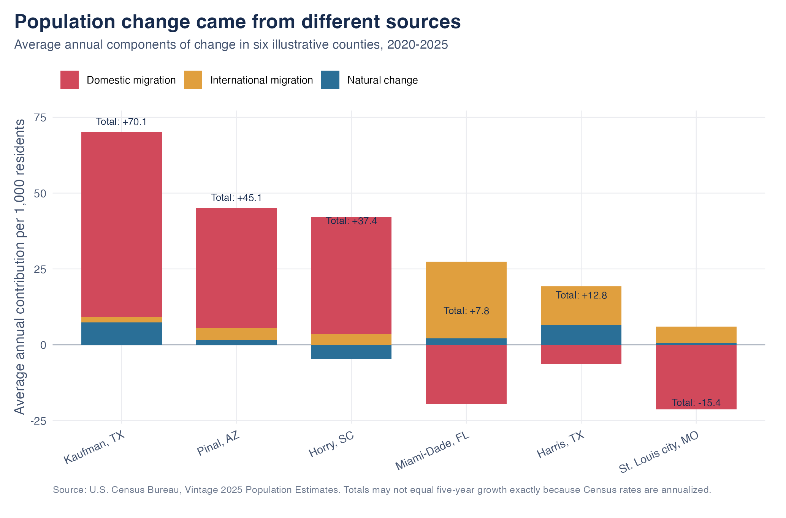

```{r setup, include=FALSE}
knitr::opts_chunk$set(echo = TRUE, warning = FALSE, message = FALSE)
source("analysis.R")
library(readr)
library(dplyr)
library(knitr)
county <- read_csv("data/processed/county_population_migration_2020_2025.csv",
                   show_col_types = FALSE)
summary_stats <- read_csv("data/processed/summary_statistics.csv",
                          show_col_types = FALSE)
stat <- function(name) summary_stats$value[summary_stats$statistic == name]
top_growth <- county |> filter(pop_2020 >= 20000) |>
  slice_max(pop_growth_pct, n = 1, with_ties = FALSE)
bottom_growth <- county |> filter(pop_2020 >= 20000) |>
  slice_min(pop_growth_pct, n = 1, with_ties = FALSE)
fmt_pct <- function(x, digits = 1) paste0(round(x, digits), "%")
```

::: {.eyebrow}
POPULATION SHIFT
:::

Between 2020 and 2025, U.S. population growth was geographically concentrated rather than evenly distributed. This article asks where counties grew or shrank—and how closely that pattern followed domestic migration.

::: {.key-numbers}
::: {.key-number}
## `r round(100 * stat("share_growing"))`%
of counties gained population
:::
::: {.key-number}
## `r fmt_pct(stat("median_growth"))`
median county population growth
:::
::: {.key-number}
## `r round(stat("correlation"), 2)`
correlation between domestic migration and growth
:::
:::

## Growth concentrated in the South and Mountain West

::: {.column-screen-inset}
```{r figure1, echo=FALSE, out.width='100%', fig.alt='County choropleth map of the contiguous United States showing population growth from 2020 to 2025 concentrated in the South and Mountain West, with declines common in parts of the Midwest, Mississippi Delta, and Appalachia.'}

```
:::

The map shows a broad arc of faster-growing counties through Florida, the Carolinas, Tennessee, Texas, and the Mountain West. Declines were more common in parts of the Great Plains, the Mississippi Delta, Appalachia, and the industrial Midwest. Among counties with at least 20,000 residents, **`r top_growth$county`, `r top_growth$state` grew by `r fmt_pct(top_growth$pop_growth_pct)`**, while **`r bottom_growth$county`, `r bottom_growth$state` changed by `r fmt_pct(bottom_growth$pop_growth_pct)`**.

A national average misses this divide. Population gains can widen a local labor force and consumer base, but also intensify pressure on housing, schools, and infrastructure. Persistent decline creates the opposite challenge: maintaining services with a smaller tax base and population.

## Domestic migration reinforced the same geography

::: {.column-screen-inset}
```{r figure2, echo=FALSE, out.width='100%', fig.alt='County choropleth map of average annual net domestic migration per 1,000 residents from 2020 to 2025, showing inflows across much of the South and Mountain West and outflows in many large urban and northern counties.'}

```
:::

Many counties that grew quickly also received more residents from elsewhere in the United States than they lost. The strongest shared pattern appears across Florida, Texas, the Carolinas, Tennessee, and the interior West. Several counties around large urban centers and in northern regions instead recorded domestic outflows.

Migration is not the full explanation. A county can lose domestic residents yet grow through international migration or natural increase; it can also receive domestic migrants but grow slowly when deaths exceed births. Domestic migration is one important component of population change, not a causal explanation by itself.

## Migration mattered—but did not determine every outcome

::: {.column-screen-inset}
```{r figure3, echo=FALSE, out.width='100%', fig.alt='Scatterplot showing a strong positive relationship between county domestic migration rates and population growth from 2020 to 2025, with points colored by Census region and sized by population.'}

```
:::

For counties with at least 20,000 residents, the correlation between average annual domestic migration and five-year population growth is **`r round(stat("correlation"), 2)`**. Counties receiving more domestic migrants generally grew faster, and many Southern and Western counties sit in the upper-right part of the figure.

The remaining spread matters. Counties with similar migration rates can have different growth outcomes because international migration and natural change also vary. The fitted line is descriptive—not causal. Housing supply, jobs, amenities, taxes, climate, and migration can all influence one another.

## The exceptions reveal what migration alone misses

::: {.column-screen-inset}
```{r figure4, echo=FALSE, out.width='100%', fig.alt='Stacked bar chart for six illustrative counties showing average annual contributions from domestic migration, international migration, and natural change. It shows that some counties grew despite domestic outflow because international migration and natural increase offset the outflow.'}

```
:::

The first three counties show the dominant pattern: strong domestic inflows were the largest source of population growth. Kaufman County, Texas; Pinal County, Arizona; and Horry County, South Carolina all gained residents primarily through movement from elsewhere in the United States.

Miami-Dade County, Florida and Harris County, Texas show why the migration map cannot be read alone. Both experienced domestic outflows, but international migration and natural increase more than offset those losses. St. Louis city, Missouri provides the opposite case: domestic outflow was not offset by the other components, producing an overall decline. These examples make the central point more precise—domestic migration is a powerful contributor to geographic redistribution, but total population change has multiple sources.

## Takeaway

U.S. population change from 2020 to 2025 formed clear regional clusters. Growth concentrated across much of the South and Mountain West, while decline was common in parts of the Midwest, Great Plains, Appalachia, and Mississippi Delta. Domestic migration reinforced that redistribution without fully determining it.

For policymakers and local businesses, the implication is practical: places gaining residents may need more housing and infrastructure, while places losing residents face the difficult task of sustaining services and opportunity with fewer people.

## Methods and limitations

I use the U.S. Census Bureau's [Vintage 2025 Population Estimates](https://www.census.gov/data/tables/time-series/demo/popest/2020s-counties-total.html) and [2025 Cartographic Boundary Files](https://www.census.gov/geographies/mapping-files/time-series/geo/cartographic-boundary.html). The reproducible script downloads both sources, joins population data to counties with the five-digit GEOID, and analyzes the contiguous United States. Alaska and Hawaii are excluded from the maps so they do not need to be resized or repositioned.

Population growth is the percentage change between July 2020 and July 2025. Domestic migration is the average annual net domestic migration rate from 2020-21 through 2024-25, reported per 1,000 residents so counties of different sizes are comparable. Map colors are capped at -5% to 15% for growth and -15 to 30 per 1,000 for migration; capping affects only the display, not the underlying data.

These are Census estimates, not exact headcounts, and they are revised by later vintages. County averages can hide substantial differences within counties. The article describes patterns over 2020-2025; it does not establish that migration causes population growth.

::: {.sources}
**Data accessed:** October 18, 2026. **Sources:** U.S. Census Bureau Population Estimates Program and 2025 Cartographic Boundary Files. See the README for exact replication instructions.
:::
