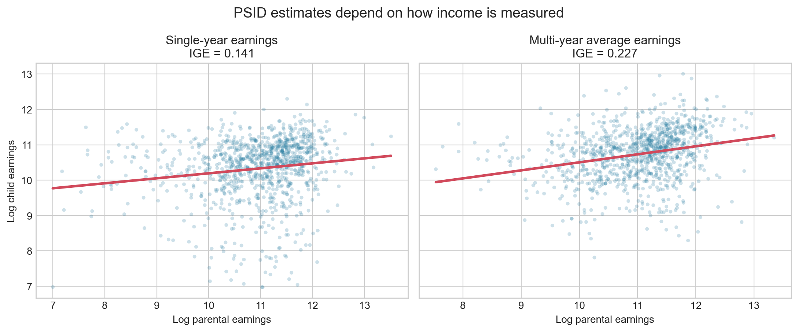
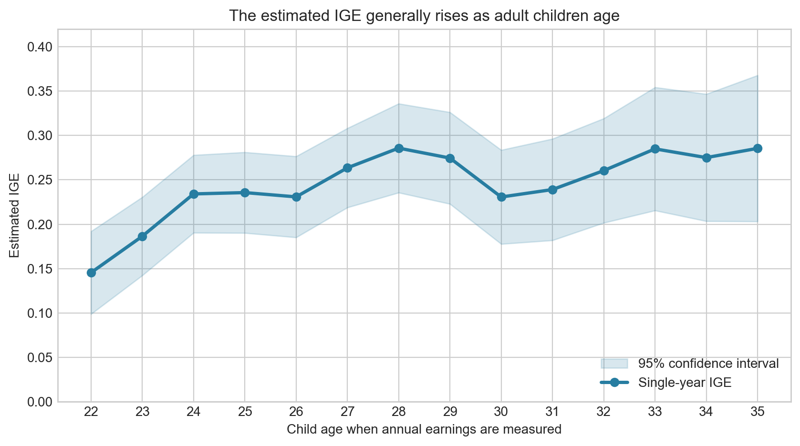

::: {.eyebrow}
INTERGENERATIONAL MOBILITY
:::

How much of the income gap between parents carries into the next generation? The **intergenerational elasticity of income (IGE)** summarizes that persistence. An IGE of 0.20 means that a 10% difference in parental earnings is associated with about a 2% difference in child earnings. Estimating the regression is straightforward; constructing a valid parent-child sample and measuring long-run income are harder.

This tutorial uses public-use data from the [Panel Study of Income Dynamics (PSID)](https://psidonline.isr.umich.edu/) and runs SQL inside Python. The PSID has followed U.S. families and their descendants since 1968. Its Parent Identification File supplies biological-parent IDs, while the Cross-year Individual File supplies birth years and repeated earnings observations.

::: {.key-numbers}
::: {.key-number}
## 1,054
matched observations
:::
::: {.key-number}
## 0.141
single-year IGE
:::
::: {.key-number}
## 0.227
multi-year IGE
:::
:::

## Step 0: Set up Python and SQLite

The downloadable PSID files use fixed-width text rather than CSV. The full parser in `code/analysis.py` reads only the required columns, removes documented missing codes, and converts earnings to 2023 dollars with CPI-U. We then place three tidy tables in an in-memory SQLite database.

```python
import sqlite3

import numpy as np
import pandas as pd
import statsmodels.api as sm

from code.analysis import load_psid_source_files

people, parent_links, income = load_psid_source_files()

conn = sqlite3.connect(":memory:")
people.to_sql("people", conn, index=False, if_exists="replace")
parent_links.to_sql("parent_links", conn, index=False, if_exists="replace")
income.to_sql("income", conn, index=False, if_exists="replace")
```

## Step 1: Match parents and children

PSID identifies each person with a 1968 family ID plus a person number. The `parent_links` table contains a child's ID, a biological parent's ID, and whether that parent is the mother or father.

```python
match_query = """
SELECT
    l.child_id,
    l.parent_id,
    l.parent_type,
    c.birth_year AS child_birth_year,
    p.birth_year AS parent_birth_year
FROM parent_links AS l
JOIN people AS c ON l.child_id = c.person_id
JOIN people AS p ON l.parent_id = p.person_id
WHERE c.birth_year BETWEEN 1945 AND 1972
  AND p.birth_year < c.birth_year - 12;
"""

matches = pd.read_sql_query(match_query, conn)
matches.to_sql("matches", conn, index=False, if_exists="replace")
```

`SELECT` chooses the returned columns. The first `JOIN` attaches the child's characteristics, and the second attaches the parent's. The `ON` clauses use stable individual identifiers rather than names or current household membership. The age-gap condition removes clearly invalid links, while the parent-type field keeps the relationship auditable.

## Step 2: Construct income measures

For each child-year, parental earnings equal the sum of available earnings for linked biological parents. The single-year measure uses parental earnings when the child was 14 and child earnings at age 25. The multi-year measure averages parental earnings while the child was 10-18 and child earnings at ages 30-35. The common sample requires at least five parental years, three adult-child years, and real annual earnings of at least $1,000.

```python
income_query = """
WITH parent_year AS (
  SELECT m.child_id, i.year,
    SUM(i.income_real) AS parent_income,
    MAX(i.year - m.child_birth_year) AS child_age
  FROM matches AS m
  JOIN income AS i ON m.parent_id = i.person_id
  WHERE i.income_real >= 1000
  GROUP BY m.child_id, i.year
),
parent_measures AS (
  SELECT child_id,
    MAX(CASE WHEN child_age = 14 THEN parent_income END)
      AS parent_income_single,
    AVG(CASE WHEN child_age BETWEEN 10 AND 18 THEN parent_income END)
      AS parent_income_multi,
    COUNT(DISTINCT CASE WHEN child_age BETWEEN 10 AND 18 THEN year END)
      AS parent_years
  FROM parent_year
  GROUP BY child_id
)
SELECT * FROM parent_measures;
"""
```

`GROUP BY` creates one record per child-year and then one record per child. `SUM()` combines earnings across linked parents. `MAX(CASE WHEN ...)` selects one age, while `AVG(CASE WHEN ...)` performs the multi-year aggregation. The complete script applies the same logic to adult-child earnings and joins the two measures into a common analysis sample.

## Step 3: Estimate the IGE

Python estimates

$$\log(Y_{child})=\alpha+\beta\log(Y_{parent})+\varepsilon,$$

where $\beta$ is the IGE. HC1 robust standard errors describe sampling uncertainty.

```python
def estimate_ige(data, parent_col, child_col):
    sample = data[[parent_col, child_col]].dropna()
    x = sm.add_constant(np.log(sample[parent_col]))
    y = np.log(sample[child_col])
    return sm.OLS(y, x).fit(cov_type="HC1")
```

| Income definition | Ages used | IGE | Robust SE | 95% CI |
|:--|:--|--:|--:|:--|
| Single year | Parent: child age 14; child: age 25 | 0.141 | 0.030 | [0.082, 0.200] |
| Multi-year averages | Parent: child ages 10-18; child: ages 30-35 | 0.227 | 0.029 | [0.170, 0.284] |

::: {.column-screen-inset}
{fig-alt="Two scatterplots of log parental and child earnings. The single-year IGE is 0.141 and the multi-year IGE is 0.227 in a common sample of 1,054 observations."}
:::

The multi-year estimate is about 61% larger. This comparison changes both the child's age and the number of years averaged, so it should not be interpreted as a pure averaging effect. Instead, it shows how the complete measurement strategy can materially change the mobility estimate.

## Life-cycle bias

::: {.column-screen-inset}
{fig-alt="A line chart of the estimated single-year IGE from child ages 22 through 35. Estimates are generally lower in the early twenties and higher in the thirties, with 95 percent confidence intervals."}
:::

To isolate age more clearly, the age profile holds the multi-year parental measure fixed and re-estimates the IGE using one child earnings observation at each age. The estimate is 0.145 at age 22 and generally rises, reaching 0.286 at age 35. It is not perfectly monotonic because the available sample changes by age and the PSID estimates contain sampling noise.

Early-career earnings can be a poor proxy for permanent economic status. Some eventual high earners are still in school, training, or low-paid entry jobs, while layoffs, bonuses, illness, and measurement error create temporary fluctuations. Averaging several observations at more mature ages reduces this noise and better approximates long-run status.

## Takeaway

SQL provides a transparent and reproducible way to link parents and children and aggregate their longitudinal earnings. But a correct match alone does not guarantee a credible mobility estimate. In the common PSID sample, the IGE rises from 0.141 with single-year measures to 0.227 with multi-year measures taken at more representative ages. Reliable mobility analysis therefore requires both careful identifier-based data construction and income measures that approximate long-run economic status.

## Methods and data note

The analysis is based on unweighted public-use PSID records and should not be read as a nationally representative or causal estimate. Income concepts vary somewhat across the long historical file; the script harmonizes individual money, taxable, labor, and earnings measures and expresses them in 2023 dollars. Raw PSID microdata require free registration and are not redistributed in this repository; exact download and replication instructions are in the README.

::: {.sources}
**Data sources:** [PSID Cross-year Individual and Parent Identification files](https://simba.isr.umich.edu/Zips/ZipMain.aspx); [BLS CPI-U series CUUR0000SA0](https://data.bls.gov/timeseries/CUUR0000SA0). **Analysis date:** October 21, 2026.
:::
