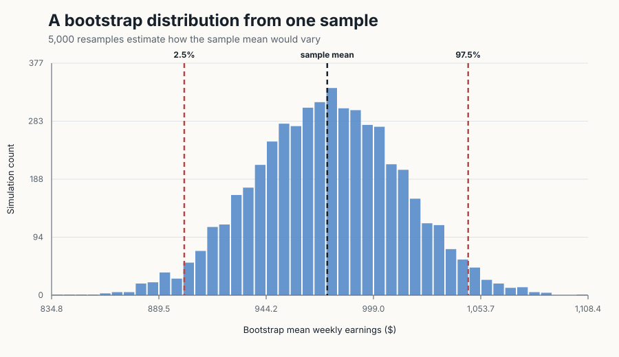
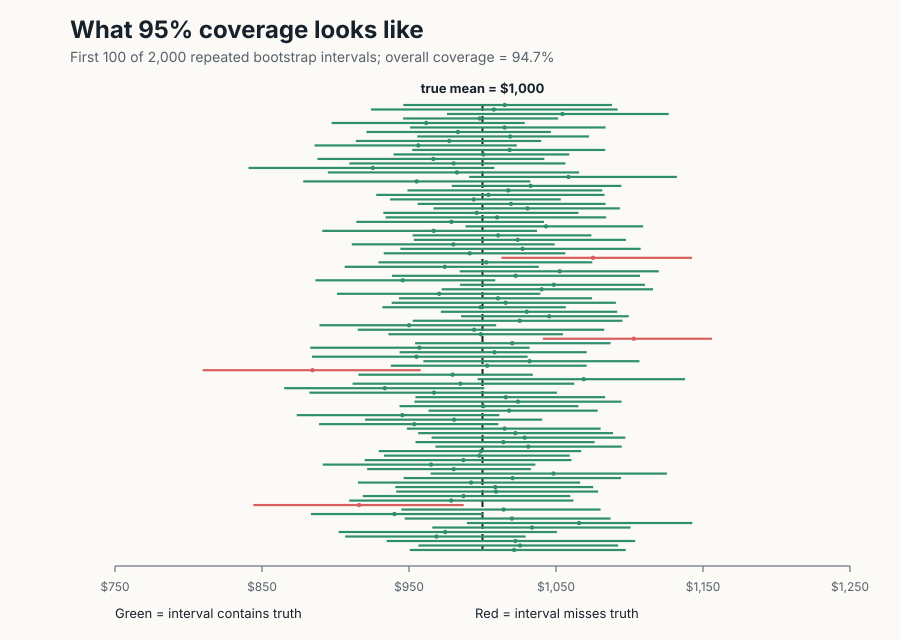
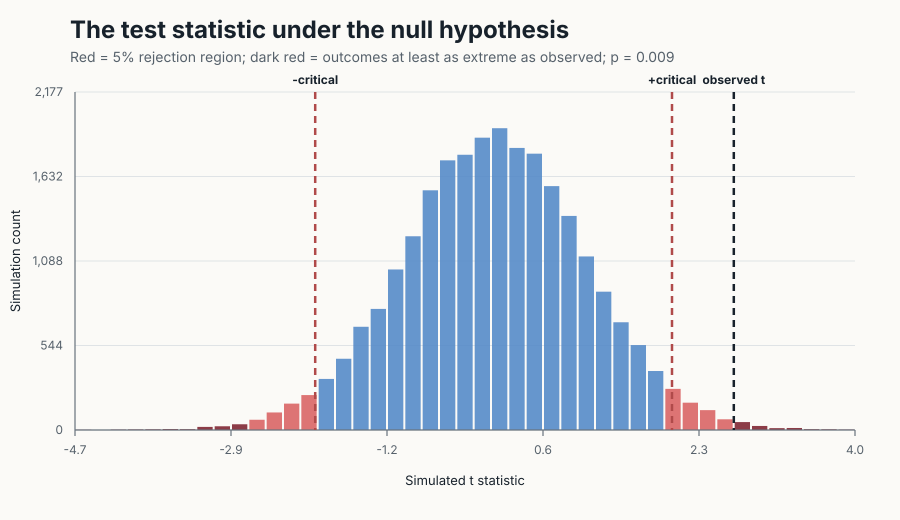

::: {.eyebrow}
SIMULATION AND INFERENCE
:::

Suppose a study reports a 95% confidence interval. It is tempting to say that this particular interval has a 95% chance of containing the truth. That interpretation sounds natural, but it is not what frequentist confidence means. The population parameter is fixed; the interval changes from sample to sample.

I use simulation to make that distinction visible. The setting is deliberately simple: weekly earnings follow a normal distribution with a true mean of **$1,000** and a standard deviation of **$250**. Because the data are synthetic, I know the answer and can check how often the statistical procedure succeeds. I then use the same framework to show how rejection regions and p-values arise from a null distribution.

::: {.key-numbers}
::: {.key-number}
## 5,000
bootstrap resamples
:::
::: {.key-number}
## 94.7%
simulated coverage
:::
::: {.key-number}
## 0.009
empirical p-value
:::
:::

## Rebuilding a sample from itself

I first draw a sample of 50 workers. Their average weekly earnings are **$975.39**. A bootstrap treats that observed sample as a stand-in for the population: draw 50 observations from it with replacement, calculate a new mean, and repeat. The 5,000 resulting means show how much the estimate could vary across similar samples.

```python
rng = np.random.default_rng(8048)
sample = rng.normal(1000, 250, 50)

bootstrap_means = rng.choice(
    sample, size=(5000, 50), replace=True
).mean(axis=1)

bootstrap_ci = np.quantile(bootstrap_means, [0.025, 0.975])
```

::: {.column-screen-inset}
{fig-alt="Histogram of 5,000 bootstrap sample means. Dashed lines identify the sample mean and the 2.5th and 97.5th percentiles."}
:::

The percentile interval is **[$902.46, $1,047.27]**. It contains the true $1,000 mean, but that is not guaranteed. The bootstrap only sees the original observations. If the first sample is unusually high or low, the interval may miss the truth.

## Watching 95% coverage happen

To evaluate the method rather than one interval, I repeat the entire experiment 2,000 times. Each experiment draws a new sample of 50 workers, performs 999 bootstrap resamples, and constructs a new 95% interval. Green lines in the figure contain the true mean; red lines do not.

::: {.column-screen-inset}
{fig-alt="One hundred simulated confidence intervals. Green intervals cross the true mean of 1,000 dollars, while red intervals miss it."}
:::

Across all 2,000 experiments, **94.7%** of the intervals contain $1,000. This is close to the advertised 95%. Before collecting data, the procedure has about a 95% long-run success rate. After one interval has been calculated, it either contains the fixed parameter or it does not.

## Building a null world

For hypothesis testing, suppose the null hypothesis is $H_0: \mu = 950$. The observed sample has a mean of **$1,022.80** and a t statistic of **2.68**. I simulate 25,000 samples from a population where the null is true and calculate the same statistic for each one. This creates the distribution of results we would expect if mean weekly earnings really were $950.

::: {.column-screen-inset}
{fig-alt="Histogram of simulated t statistics under the null hypothesis. The outer five percent forms the rejection region, and darker tails beyond the observed statistic form the empirical p-value."}
:::

The outer 5% of the null distribution, beyond approximately **±1.99**, is the two-sided rejection region. The observed statistic lies beyond the upper cutoff. Only **0.9%** of null simulations are at least as extreme in absolute value, so the empirical p-value is 0.009 and I reject $H_0$ at the 5% level.

The p-value is not the probability that the null hypothesis is true. It is the proportion of simulated null outcomes that are at least as incompatible with the null as the observed result.

## Change the experiment

::: {.interactive-note}
**Try this:** Increase the sample size and watch the bootstrap distribution narrow. Then raise the confidence level and see why a more reliable interval must become wider.
:::

<iframe src="interactive/bootstrap_explorer.html" title="Interactive bootstrap explorer" loading="lazy"></iframe>

## Takeaway

Simulation separates three ideas that are often blended together. A bootstrap distribution approximates sampling uncertainty using the observed data. A 95% confidence level describes the long-run performance of an interval-building procedure, not the probability attached to one finished interval. A p-value is a tail proportion in a world where the null hypothesis is true. Once those repeated experiments are visible, statistical inference becomes less about memorizing definitions and more about asking what would happen if the study were run again.

::: {.sources}
**Data and reproducibility:** All observations are synthetic and generated with fixed random seeds; they do not describe an actual workforce. The Python script recreates every result table and figure. Exact replication instructions and statistical definitions are included in the README.
:::

