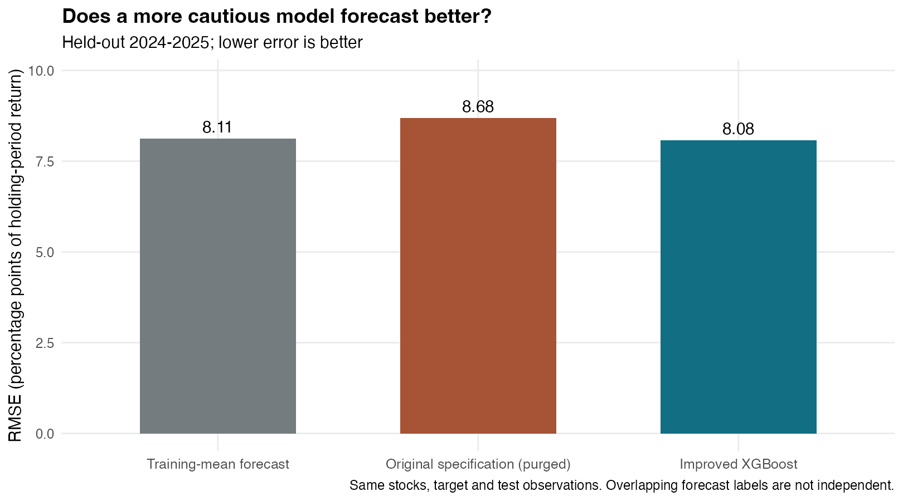
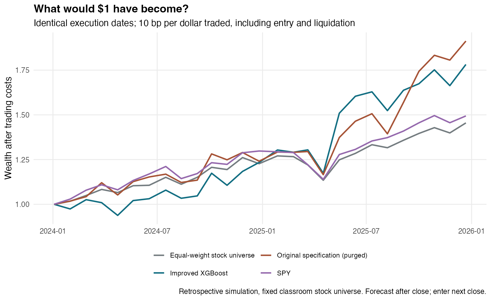
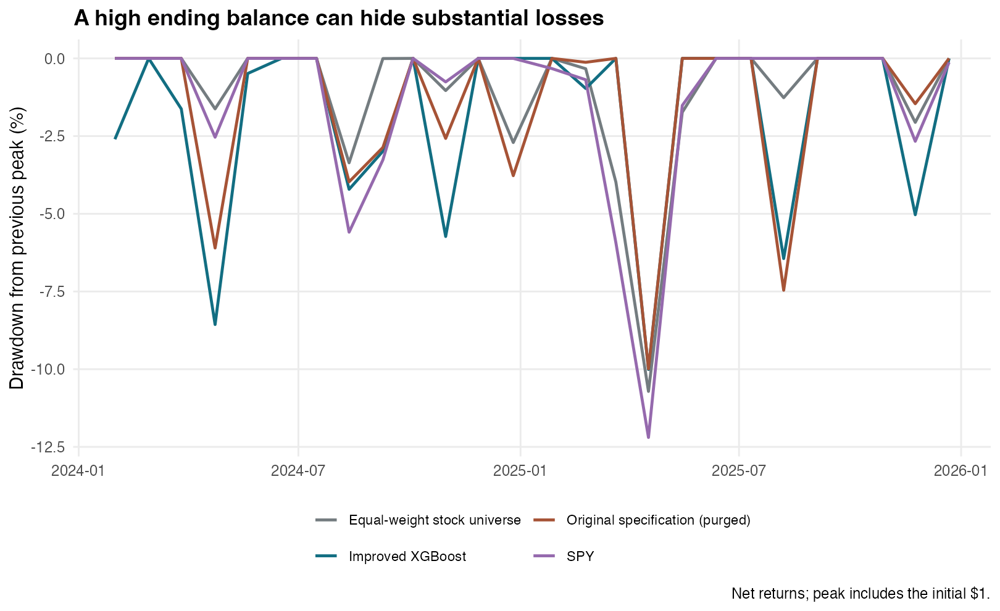

::: {.eyebrow}
STOCK RETURNS AND MACHINE LEARNING
:::

Our classroom project used **Investopedia Simulator** to compare two virtual portfolios, each starting with **$100,000**, over a planned two-month horizon. One used intuition; the other used financial analysis. Our group used the supplied broad-universe XGBoost script for the analytical portfolio. Reported final values were **$99,093.21** and **$97,108.55**: returns of -0.91% and -2.89%. Analysis trailed by 1.98 percentage points. Could a more cautious model improve its predictions and investment decisions?

The class workbook provides context: analysis finished ahead for 30 of 45 teams, but teams could use different indicators or methods. Without their holdings and exact execution dates, these outcomes cannot isolate XGBoost skill. The historical backtest below is a separate experiment, not a reconstruction of our simulator trades.

## What the classroom model actually does

The confirmed script lists **95 stocks across multiple sectors**, despite a comment describing 100. Its recipe retains open, high, low, close, volume, adjusted price, daily return and SPY return, alongside six engineered momentum, volatility and relative-return signals. Stock identity and date are excluded from prediction. The target is adjusted price at t+20 divided by price at t+1, minus one: **19 trading intervals**.

Gradient boosting adds trees sequentially to correct the existing ensemble. The classroom model uses 300 trees, depth five and learning rate 0.05. It ranks stocks, selects the top ten, and assigns weights proportional to positive forecasts; all-negative selections receive equal weights.

## Why try a simpler model?

The concern is overfitting, not a prior conclusion that the original model fails. Although pooling stocks produces many rows, training covers only 2022-2023; common market shocks and overlapping return windows reduce independent information. Complex trees may learn temporary patterns rather than stable relationships.

I remove raw price levels and volume, retaining return-based signals and adding stock identity, current-day return, current 21-day momentum, and market momentum and volatility. These provide stock-specific and market context without relying on nominal price scales. Shallower trees allow fewer interacting conditions; smaller updates and stricter split requirements restrain noise fitting.

Two forward validation blocks in 2023 compare 100 or 300 trees at depth one or two, selecting **100 trees, depth 1**. Learning rate 0.03, minimum child weight 50 and 80% row subsampling are preset conservative choices, not exhaustively tuned. The 2024-2025 test set does not select parameters.

## Evaluating without looking ahead

Yahoo Finance data cover 2022-2025; all 95 requested stocks have complete coverage. The main classroom-model comparator preserves its inputs, formulas and hyperparameters, but removes 1900 training labels whose outcomes cross into 2024. Validation boundaries are purged similarly. A literal classroom-split diagnostic is saved separately.

Both strategies form signals after close, enter at the next close and hold for 19 intervals. Holdings are contiguous and nonoverlapping. I correct the original scalar `ifelse` weight-recycling issue so weights sum to one, align SPY holding windows, and use holding-period rather than daily annualization. These shared evaluation repairs are distinct from changing the prediction model.

## What changed in predictive performance?

Across **45,790 held-out stock-date forecasts**, RMSE falls from **8.68** to **8.08 percentage points**. RMSE penalizes large errors. The training-mean benchmark achieves **8.11** points, so improvement over this simple rule is small: out-of-sample R-squared is **0.009**, about 0.9% less squared error. Direction accuracy still trails the always-positive mean forecast. This is limited descriptive evidence, not proof of persistent predictability.

| Forecast | RMSE (pp) | MAE (pp) | Direction accuracy | OOS R² |
|:--|--:|--:|--:|--:|
| Training mean | 8.11 | 5.97 | 57.19% | 0.000 |
| Classroom model, purged | 8.68 | 6.44 | 51.74% | -0.145 |
| Improved XGBoost | 8.08 | 5.96 | 56.06% | 0.009 |

::: {.column-screen-inset}

:::

## Do better forecasts make better investments?

Both models retain the top-ten allocation rule. Benchmarks hold the entire stock universe equally weighted, rebalanced on the same dates, or SPY. Costs are **10 basis points per dollar bought or sold**, including initial entry and final liquidation, using drifted pretrade weights. There are 26 holdings, January 3, 2024 through December 22, 2025.

Net returns are **91.2%** for the classroom model and **78.2%** for the improved model, versus **45.5%** for equal-weight stocks and **49.4%** for SPY. Annualized Sharpe ratios are **1.34** and **1.04**, assuming a fixed 4.32% annual risk-free rate. Better average prediction accuracy did not produce a better portfolio: the strategy depends on ranking and weighting just ten stocks, while RMSE evaluates every forecast.

| Strategy | Net total return | Annualized Sharpe | Holding-boundary max drawdown |
|:--|--:|--:|--:|
| Classroom model, purged | 91.2% | 1.34 | -10.0% |
| Improved | 78.2% | 1.04 | -10.0% |
| Equal-weight 95 stocks | 45.5% | 1.20 | -10.7% |
| SPY | 49.4% | 1.20 | -12.2% |

::: {.column-screen-inset}

:::

::: {.column-screen-inset}

:::

## Takeaway

Unexpected news, competition and changing relationships make returns difficult to forecast. The broad input universe does not guarantee a diversified top-ten portfolio; sector and position concentration require the actual holdings. Without simulator trade records, I cannot attribute our classroom loss to technology exposure or an AI-related shock.

This retrospective test uses a fixed list of surviving companies and only 26 investment periods. Historical adjustments and assumed closing-price execution also limit realism. The more conservative model improves forecast error, but lowers realized return and Sharpe. Model complexity, forecast accuracy and investment usefulness are different questions—and each needs its own benchmark.

## Data and reproducibility

Prices: [Yahoo Finance](https://finance.yahoo.com/quote/SPY/history/), retrieved November 16, 2026, archived for 2022-2025. Adjusted close reflects [splits and dividends](https://in.help.yahoo.com/kb/adjusted-close-sln28256.html). See [XGBoost parameters](https://xgboost.readthedocs.io/en/stable/parameter.html).

The original source is `original/instructor_broad_universe_xgboost.R`, confirmed as the script used for our simulator project. `R_Crash_Course_Assignment.pdf` specifies the project design. The earlier five-stock adaptation is retained only as background and is not used for these results. The 113-team example in the assignment describes a previous semester; the supplied workbook contains 45 teams.

[Download the complete replication project](replication.zip), [README](README.txt), [analysis code](code/analyze.R), [forecast results](results/prediction_metrics.csv), [investment results](results/investment_metrics.csv), or [portfolio holdings](results/weights.csv). Source: [my website repository](https://github.com/sijiexu-jennifer/jenniferxu-website).

```bash
Rscript code/analyze.R
Rscript code/classroom.R
Rscript code/publish.R
quarto render index.qmd
```

No new download is needed. `publish.R` generates this Quarto source from saved results; render it in the existing website to retain its established styling. Holdings and entry/exit dates are saved. Sharpe annualization uses 252/19 periods per year; drawdown is sampled at holding ends. Initial and final costs are charged to every strategy. No formal significance or causal-alpha claim is made.
